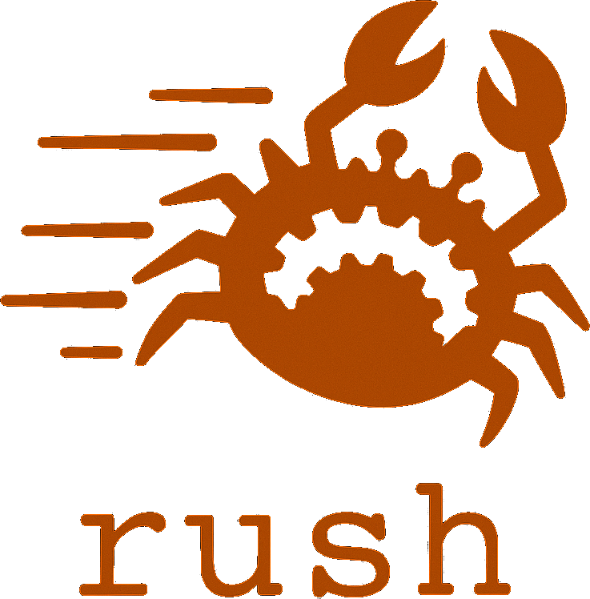

<p align="center">
  
</p>

# Rush

Rush is an experimental build system written in Rust. It reads Bazel-style
workspaces, evaluates build rules, schedules actions, and caches their outputs.
The project explores how persistent analysis and content-addressed storage can
reduce repeated build work.

Rush is under active development. Compatibility depends on the rules,
toolchain and configuration you use. Validate it against your existing build
before relying on its results. This source release makes no general speedup
or full Bazel compatibility claim.

## Build and try it

Install a Rust toolchain with Cargo, a C/C++ toolchain, and the native development
dependencies required by your platform. Some integration tests require additional
tools. The Linux capture and observation code requires Linux.

```sh
cargo build --release --locked --bin rush -j8
./target/release/rush --help
```

Try the small C++ example from its workspace:

```sh
cd examples/hello_cpp
../../target/release/rush build //:hello
```

Run the same target again to exercise reuse. For correctness investigations,
compare clean outputs and source/header edits with the reference build. A fast
no-op alone does not establish dependency correctness.

## Find your way around

The workspace contains separate crates for analysis, action identity, execution,
caching, resource admission and command transport. [MAINTAINERS](MAINTAINERS)
maps paths to responsible components and review roles.
[The architecture guide](docs/architecture.md) explains their boundaries and
the proposed order for splitting the largest modules.

Read [CONTRIBUTING.md](CONTRIBUTING.md) before preparing a change. Both Claude
Code and Codex use [AGENTS.md](AGENTS.md). The
[maintenance guide](maintenance/README.md) adopts Chores' scoped repair,
evidence and human-delegation process. Its automation policy is a proposal;
this checkout installs no recurring agent jobs.

See [the release page](index.html) for the project overview and
[workload status](docs/status/README.md) for scoped compatibility reports and
[build performance](docs/benchmarks/README.md). [TODO.md](TODO.md) lists the
first maintenance tasks. Selected published historical reports are preserved;
raw build outputs and private experiments are excluded. Preserve license
notices when redistributing Rush and its included third-party material.

## License

Rush is distributed under the [MIT license](LICENSES/MIT). Included dependencies and
fixtures retain their own license notices.
