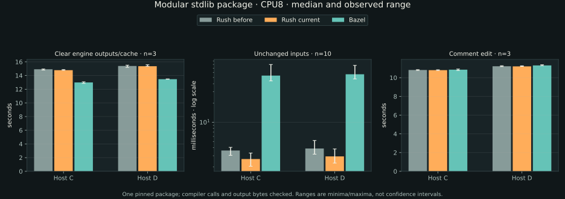
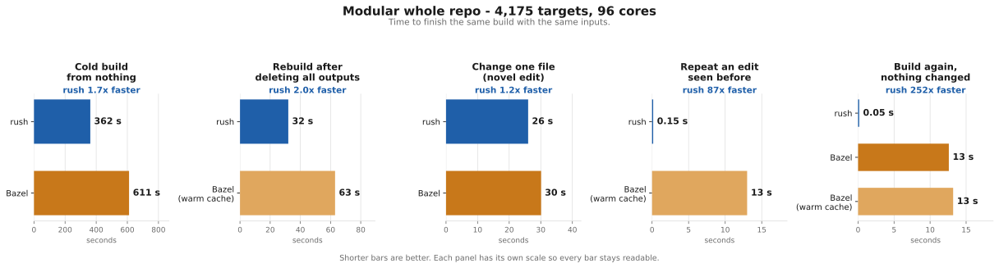
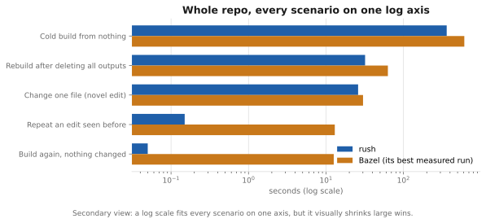
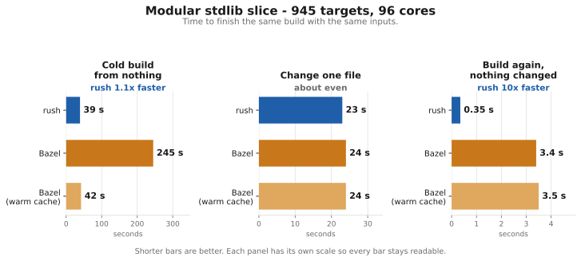

# Compare Modular package builds before extending the workload claim

Build the CPU stdlib package `//mojo/stdlib/std:std` at commit
`4e87649567a82e3bdac178ea61d62daddc7477bb`. Compare Rush before the incremental
changes (`b003cc3`) with engine `b059a25` published in `f9d97fe`, then use the
same pinned Mojo compiler through native Bazel as a reference.

## Read the November 9 two-host comparison

Use the same eight CPUs and eight requested jobs per host. Each cell gives
median [minimum, maximum]. Collect three clean-output samples, ten unchanged
commands and three distinct comment edits per engine on each host.

| Host | Operation | Rush before | Rush current | Bazel |
| --- | --- | ---: | ---: | ---: |
| Host C | Clear engine outputs/cache (s) | 14.919 [14.798, 14.952] | 14.783 [14.765, 14.867] | 12.986 [12.851, 13.083] |
| Host C | Unchanged command (ms) | 3.621 [3.041, 4.054] | 2.663 [2.057, 3.303] | 53.566 [44.242, 79.801] |
| Host C | Novel comment edit (s) | 10.822 [10.779, 10.855] | 10.803 [10.767, 10.847] | 10.858 [10.768, 10.921] |
| Host D | Clear engine outputs/cache (s) | 15.398 [15.199, 15.518] | 15.360 [15.355, 15.577] | 13.470 [13.459, 13.509] |
| Host D | Unchanged command (ms) | 3.891 [3.173, 5.189] | 2.930 [2.306, 3.826] | 56.118 [47.536, 77.270] |
| Host D | Novel comment edit (s) | 11.222 [11.185, 11.278] | 11.208 [11.206, 11.268] | 11.310 [11.286, 11.382] |

The current engine has lower unchanged-command medians on both hosts:
3.62→2.66 ms and 3.89→2.93 ms, about 26% and 25% less wall time. The sample
ranges overlap. Clean-output and comment-edit differences are small and their
ranges overlap too; use these results as evidence of lower no-op medians,
rather than a broad compilation speedup. Bazel has the lowest clean-output
median in this package profile.



Read [all 96 accepted samples](data/modular-cpu-20261109.json), their compiler
counts, source/tool identities, edit digests and output checks. Build one
package in this scope; retain the multi-target ledgers below separately.

## Reproduce the package experiment

Use Mojo `1.0.0b3.dev2026080406` and Bazel
`10.0.0-pre-46c5e789f84c7bf4ba1edb105eefa7bc4ebc841b` from the upstream
pinned toolchain. Require these executable SHA256 values:

```text
Rush before bb59c5c93317f1e31b0b553ef25fdf8b28ed04878408277e81e066d71f896133
Rush current 9869e0b075a3923b07cef4365cfbf9def89a7e71b2f4646ba5b66bae0933390a
Mojo d72d688ed65788a577100299e69d56878289271ad2c8d35e8395e17a905e791b
Bazel 202e4c8ef0e1014e85648ba27d137769bb94e27a1cd04b1b347405b24f8c6f0a
```

Run [the controller](../../benchmarks/workloads/modular.py) through
[prepare, qualify and measure](../../benchmarks/workloads/README.md).
Require qualification before timing, pin each lane's source, reject concurrent
or repeated runs, and verify source restoration after edits. Use the measured
controller SHA256 `3f0b32a6ab99d25801cb07e5f9c9a287d07c69995d219bd264c9ae27998cc4bc`.

Select the declared CPU platform with `--platforms=@platforms//host`,
`--host_platform=@platforms//host` and
`--repo_env=MODULAR_SKIP_AUTO_PLATFORMS=1` in native Bazel configuration.
Generate fresh host repositories. Keep the real pinned compiler layout;
execute package compilation without running GPU programs. Match the existing
source tree and use no upstream patches or fake device inventory.

For clean commands, remove engine outputs, action-result caches and Rush CAS;
include fresh daemon startup. Retain fetched repositories, analysis metadata
and normal compiler/tool caches. Keep the operating-system page cache warm.
Disable Bazel remote execution, remote caches and its disk cache. Keep daemons
for no-op/edit commands. Rotate engine order, use distinct comments appended
to `mojo/stdlib/std/builtin/int.mojo`, and require one complete package
precompile for every clean/edit command. Require zero precompiles for no-ops.
Count all 36 measured compiler invocations and require the same 3,265,666-byte
`std.mojoc` in all 96 builds:

```text
e70baa1ba529a4bf5e022f6e2818fd6658b8b764969b9e3e76425920bc6498b9
```

Use a monotonic clock and pidfd readiness for process completion. Exclude all
96 preliminary timing rows produced with timeout polling; their intervals
quantize short commands and distort medians. Retain their compiler/output
checks as separate correctness evidence. The accepted table uses fresh state,
qualification and the corrected timer on both hosts.

Supply the original LLVM dependency archive with its declared checksum.
A fresh download was rejected on a digest mismatch; recover the exact valid
archive from a verified download cache, then keep the upstream source and
checksum unchanged. Exclude provisioning and bootstrap from timing. Keep the
host's normal software environment frozen within each comparison. No exclusive
host reservation was held; Host C's mixed memory remains unqualified by a full
memory-stability test. Compare engines within each host: the Mojo executable
hash matches across hosts, but the complete compiler-tree hashes differ and
are retained in the sample data.

Keep command-line and analysis differences visible: these are native rule
builds with byte-identical package outputs, rather than identical schedulers
or isolated compiler-throughput tests. Measure code edits, downstream closure,
optimized applications and runtime behavior separately.

## Inspect the separate multi-target record

Build the same 4,175-target ledger at Modular pin `cc7155d`. Prefetch external
repositories for both engines and use the same configuration. The measurement
host is a 96-core x86-64 system. Report medians of three runs except for the
single-sample cold rows.

## Whole-repository results

| Operation | Rush | Bazel | Cache state |
| --- | ---: | ---: | --- |
| Compile the whole tree | **362 s** | 611 s | Cold-run intent; revalidate cache clearing |
| Restore deleted outputs | **32 s** | 63 s | Warm disk caches; output trees removed |
| Leave inputs unchanged | **0.05 s** | 12.6 s | Warm no-op; Bazel without disk cache |
| Leave inputs unchanged | **0.05 s** | 13.2 s | Warm no-op; Bazel with disk cache |
| Compile a novel one-file edit | **26.0 s** | 30.1 s | Distinct edit bytes for each run |
| Repeat an already-cached edit | **0.15 s** | ~13 s | Reuse a known input state |

Use the cache-restore row to compare output restoration: Rush takes about
half the time in this scope. Use the novel-edit row to compare an actual
recompile: 26.0 s versus 30.1 s. Keep the repeated-edit result separate;
its compiler input state already exists in the cache.



<details>
<summary>View the same whole-repository data on a logarithmic axis</summary>



</details>

## Control cache state

Clear each engine's actual action cache and content-addressed store before
measuring an uncached compile. Removing outputs alone measures restoration.
Rush's default disk cache is under `$HOME/.cache/rush`; removing a workspace's
`.cache/rush` directory does not clear that store. The 362 s / 611 s cold-run
result has one sample and an incomplete cache-reset control. Revalidate that
control before using it as a confirmed uncached speed ratio.

Use distinct source bytes for every novel-edit sample. Repeating identical
comment text measures a reusable input state. Retain that as a separate
repeated-edit experiment rather than mixing its time into the compile median.

## Stdlib slice

Use the 945-target ledger and report its scope separately from the
whole-repository tree.

| Operation | Rush | Bazel without disk cache | Bazel with warm disk cache |
| --- | ---: | ---: | ---: |
| Compile the slice | 39 s | 245 s | 42 s |
| Leave inputs unchanged | 0.35 s | 3.4 s | 3.5 s |
| Rebuild after one file changes | 23 s | 24 s | 24 s |

Apply the same cache-reset requirement to cold rows.



## Check output and runtime behavior

The build ledger reports 4,175 accepted targets, including 1,063 Python
targets. Comparable Mojo library artifacts match byte for byte in 38 of 39
cases; keep the remaining `builtin_kernels` difference visible.

The selected H100 GPU corpus contains 287 of 763 candidate tests. All 222
comparable Bazel-passing tests also pass when built by Rush. The record also
reports 12 shared failures and 36 Rush passes whose Bazel wrappers do not run
outside their runfiles environment. Recover the full case ledger to reconcile
every selected and excluded test before claiming complete runtime coverage.

Virtual output materialization reports fewer written bytes but no measured
wall-time improvement on this host. Do not add a speedup for that feature.

Read the [Modular status](../status/modular.md) for acceptance procedures and
the [measurement provenance](PROVENANCE.md) for source records. Update plots
and tables from the same sample set when repeating the comparison.
