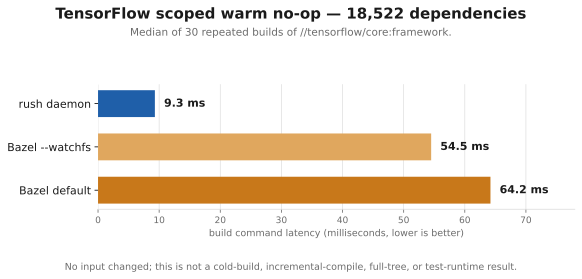

# Check TensorFlow builds before comparing latency

Build pristine TensorFlow 2.17.0 commit
`ad6d8cc177d0c868982e39e0823d0efbfb95f04c` with
`//tensorflow/core:framework`, `framework_shared_object=false`, optimization
mode `opt`, eight jobs and the same eight CPUs per host. Compare Rush before
the incremental optimizations (`b003cc3`) with the integrated engine
`b059a25` published in `f9d97fe`. Use Bazel 6.5.0 as the reference.

## Read the November 9 build checks

| Host | Rush before | Rush after | Bazel reference |
| --- | --- | --- | --- |
| Host C | Rule loading fails; zero compiler calls | Same failure | Build completes |
| Host D | Rule loading fails; zero compiler calls | Same failure | Build completes |

Both Rush versions stop while loading
`@rules_java//java/private:native.bzl`: `JavaInfo` is undefined. The failure
precedes compilation. Bazel completes 2,119 actions on each host, including
1,277 local processes and 990 instrumented compile invocations. Inspect the
framework object outputs as well as the successful exit; the top-level
framework target aggregates dependencies rather than producing a standalone
archive in this profile.

Use [the complete build-check data](data/tensorflow-build-retest-20261109.json)
for exact binary digests, source archive, defines, configuration and object
checks. Expand `CASE` to each isolated run directory, `REPOSITORY_CACHE` to
its dependency-download cache, and engine variables to the pinned executables.
Run from that case's pristine TensorFlow workspace. The compiler wrappers log
invocations and pass arguments unchanged to Clang. Retain failed attempts as
compatibility evidence. Assign no speed ratio to their durations and claim no current TensorFlow speed improvement
from the synthetic C++ results.

Preserve the initialized predeclared environment in `Evaluator::new` and
export the required native Java providers correctly. The current constructor
populates an environment and then returns a different empty one; the module
also needs `JavaPluginInfo`. Add a real module-load regression and complete
fresh framework builds before measuring clean, unchanged and edit latency.
Keep TensorFlow sources and dependency checksums unchanged; substitute no
placeholder providers or generated files to pass this gate.

## Keep the recorded no-op scope separate

The imported unchanged-command record reports `//tensorflow/core:framework`,
18,522 retained dependencies and these 30-sample medians:

| Engine | Median | Samples |
| --- | ---: | ---: |
| Rush | 9.3 ms | 30 |
| Bazel | 64.2 ms | 30 |
| Bazel with `--watchfs` | 54.5 ms | 30 |

Keep this record attached to its original scope. Its complete sample series,
exact timing candidate and host/toolchain record remain unrecovered. It does
not validate the current release or override the fresh-build failures above.
The separate TF 2.15 runtime corpus is also outside this new build check.

## Reproduce the comparison

Freeze both engines, the TensorFlow tree and configuration. Match the target,
environment and cache conditions, collect all 30 samples, and verify that
unchanged commands execute no unexpected actions. Report the distribution
and output checks. Do not derive p99 from a median.

Recover the complete sample series, exact timing-candidate identity and
toolchain/host record before claiming an independently reproduced result.
The [source record](PROVENANCE.md) identifies what is retained and what is
missing. Read [TensorFlow compatibility](../status/tensorflow.md) for build
and runtime acceptance scopes.
